# Информационная система «Обувной магазин»
Десктопное приложение для автоматизации работы обувного магазина. Система включает в себя каталог товаров, систему скидок и разграничение прав доступа для разных ролей.

## Скриншоты
### Авторизация
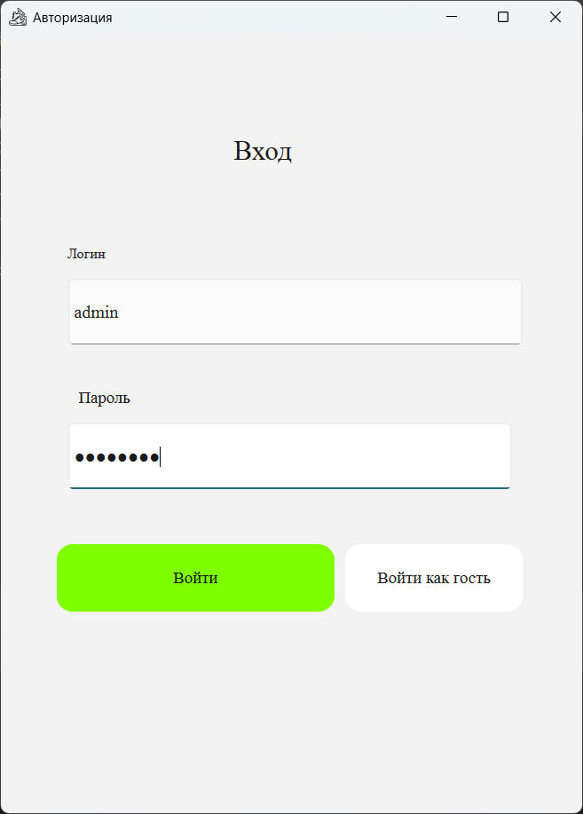

### Гостевой режим
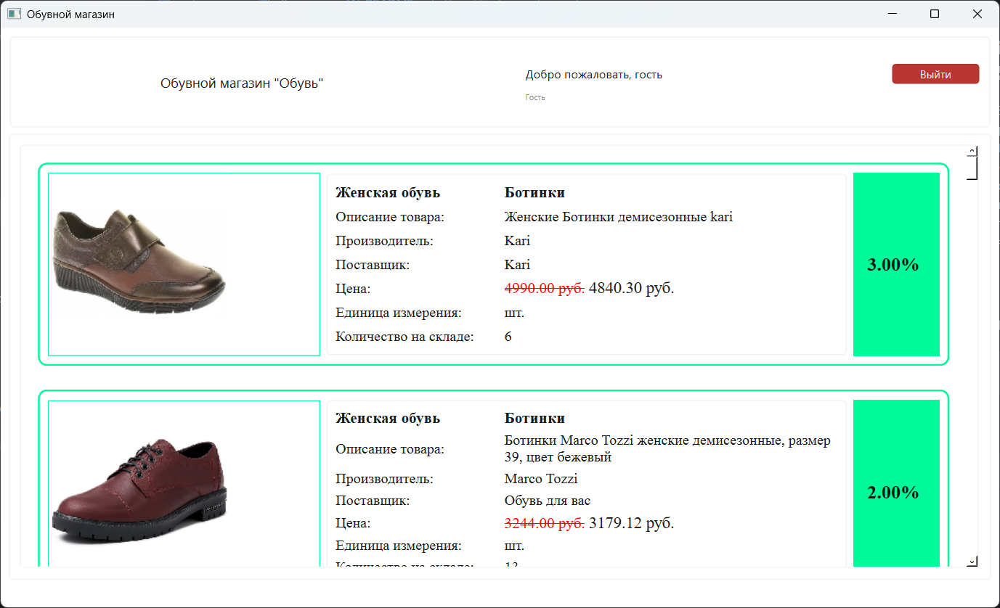

### Панель администратора
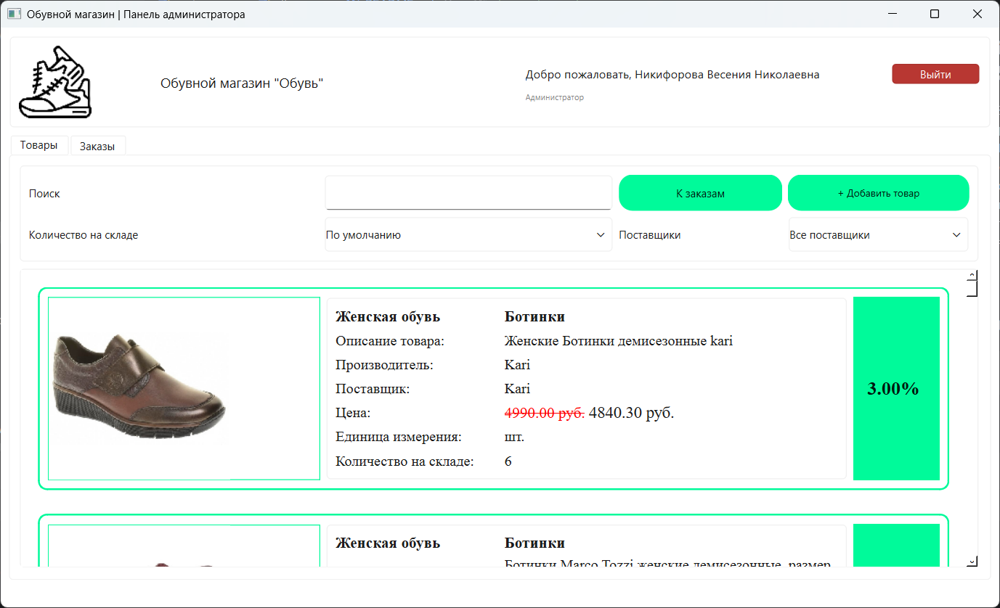
#### Поиск и фильтрация
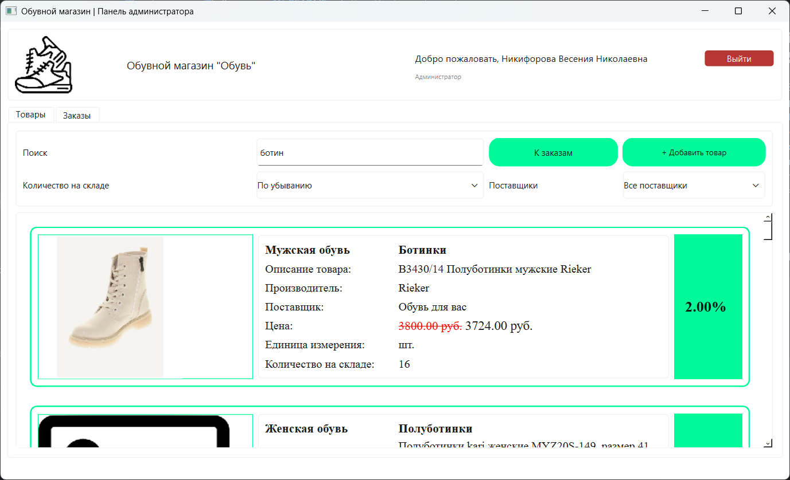
#### Добавление товара
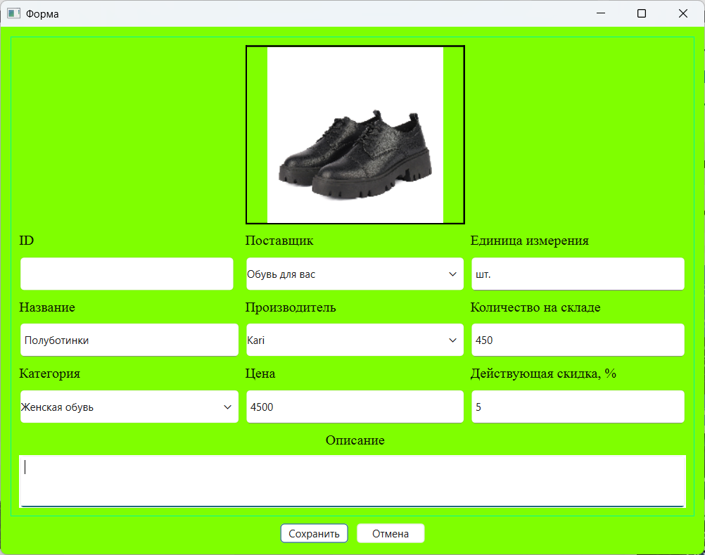
#### Редактирование товара
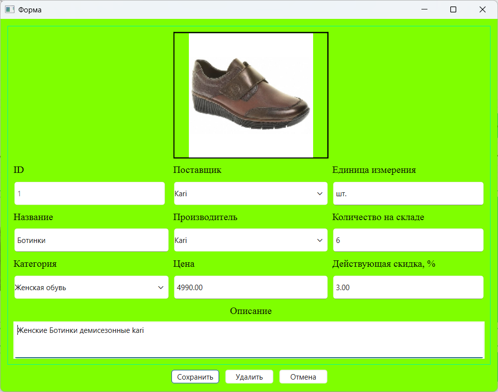
#### Заказы
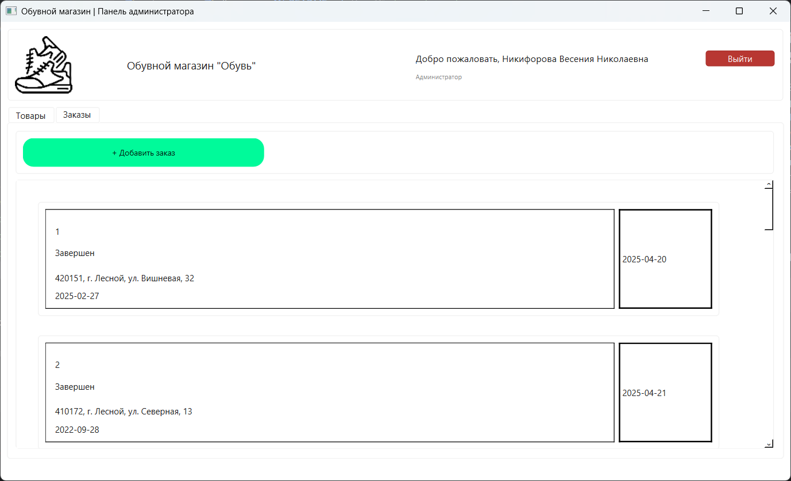
#### Редактирование заказа
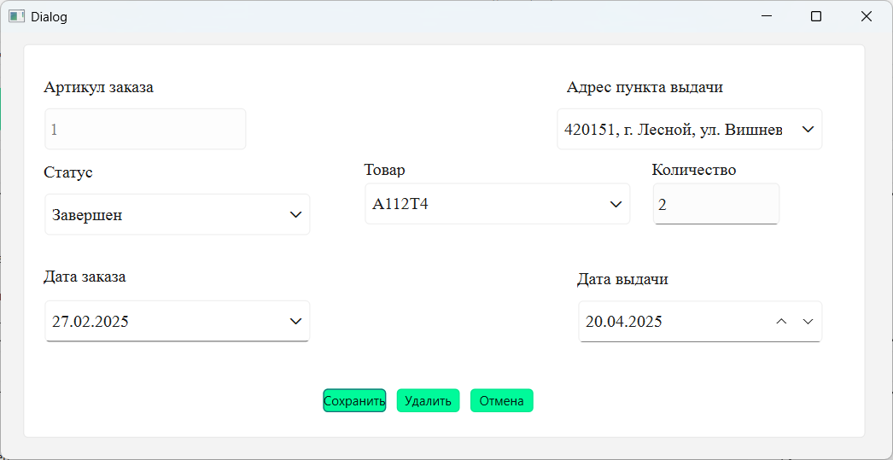
#### Добавление заказа
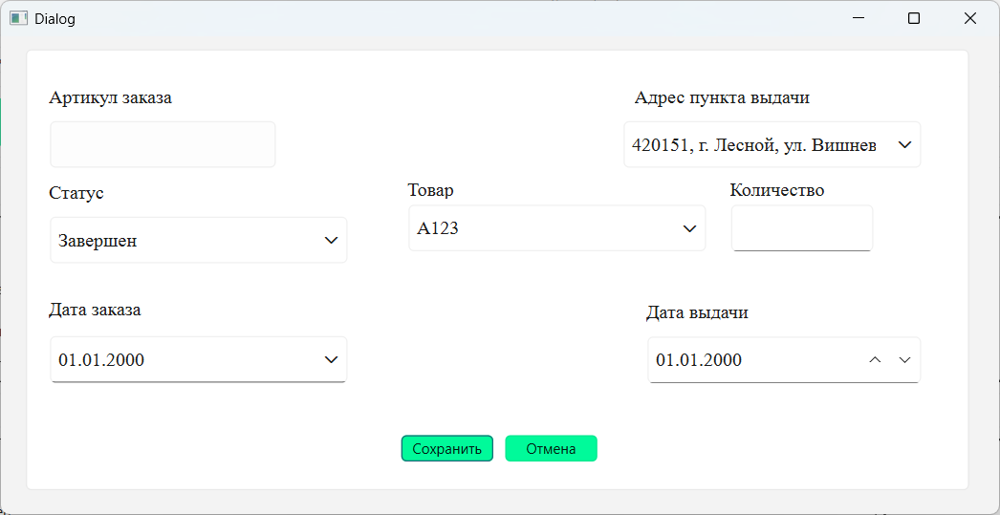

### Панель менеджера
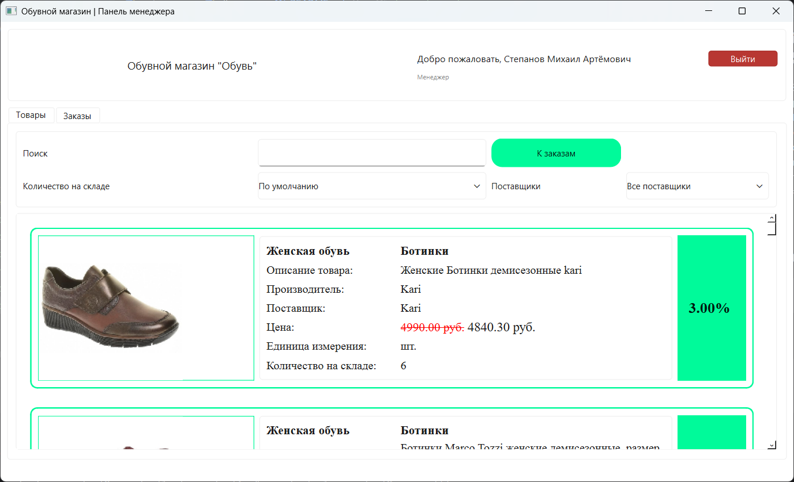
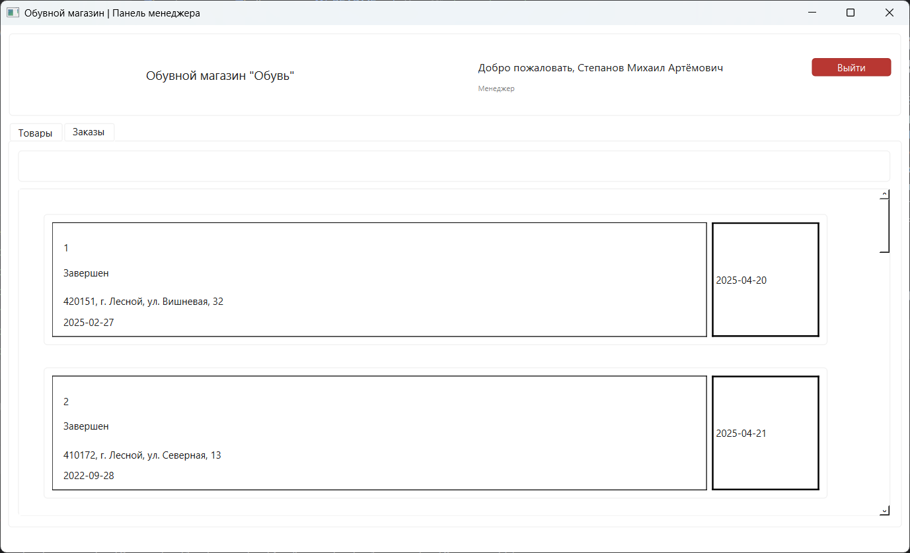

### Каталог товаров для клиента
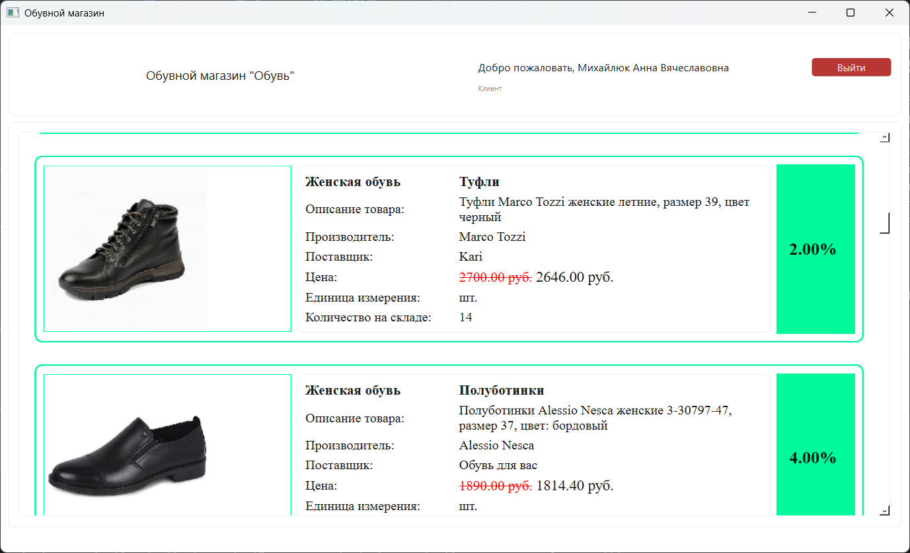


## Стек технологий
- **Язык:** Python 3
- **UI-фреймворк:** PyQt6
- **База данных:** MySQL 

## Функционал (Ролевая модель)

Приложение больше направлено на администрирование и учет товаров. Реализовано три роли, каждая из которых имеет свой уровень доступа:

### 1. Гость / Клиент
- Просмотр карточек товаров (фото, название, описание, производитель, поставщик)
- **Умный расчет цены:** если на товар действует скидка, старая цена отображается зачеркнутой, а новая выделяется
- **Визуальная индикация:** если товара нет на складе, карточка подсвечивается голубым цветом. Если скидка больше 15%, бейдж со скидкой становится зеленым
- Поиск по всем характеристикам товара

### 2. Менеджер
- Имеет доступ к каталогу товаров (с поиском, фильтрацией по поставщикам и сортировкой по количеству на складе)
- Имеет доступ к вкладке «Заказы» (просмотр списка заказов, статусов и пунктов выдачи)
- Не может добавлять или редактировать товары и заказы

### 3. Администратор
- Полный доступ к управлению товарами: добавление новых позиций и редактирование существующих
- Полный доступ к управлению заказами 
- Фильтрация и сортировка товаров
- Редактирование заказа или товара происходит при нажатии на соответствующую карточку, добавление при нажатии на кнопку "Добавить"

   
## Структура проекта

```text
shoes-shop-app/
├── assets/                 # Изображения (логотип, фото товаров, иконки)
├── database/
│   └── db.py               # Подключение к БД, функции запросов и resource_path
├── dialogs/
│   ├── order_form.py       # Логика диалога создания/редактирования заказа
│   └── product_form.py     # Логика диалога создания/редактирования товара
├── ui_py/                  # Сгенерированные файлы интерфейсов из Qt Designer
│   ├── login_win.py
│   ├── main_win.py
│   ├── order_card.py
│   └── product_card.py
├── win/                    # Классы-контроллеры окон
│   ├── admin_win.py
│   ├── client_win.py
│   └── manager_win.py
├── main.py                 # Точка входа, окно авторизации
├── shoes_shop.sql          # Дамп базы данных (структура и тестовые данные)
├── requirements.txt        # Зависимости
└── README.md
```

## Как установить и запустить проект
Клонируйте репозиторий:
```
git clone https://github.com/anarkulovab/shoes_shop_desktop_python.git
cd shoes_shop_desktop_python
```

###Требования
- Python 3.9+
- MySQL 8.0
- Open Server

## Установите зависимости:
```
pip install -r requirements.txt
```

## Настройте базу данных MySQL:
Запустите сервер MySQL (например, через OpenServer)
Импортируйте базу данных из файла shoes_shop.sql в phpMyAdmin или MySQL Workbench
По умолчанию в файле database/db.py настроено подключение: хост localhost, пользователь root, пароль root, база данных shoes_shop. Если ваши настройки отличаются, измените их в db.py.

## Запустите приложение:
```
python main.py
```

## Тестовые аккаунты (из базы данных)
Для проверки функционала используйте следующие логины и пароли:
- Администратор: логин admin, пароль admin123
- Менеджер: логин manager, пароль manager123
- Клиент: логин client, пароль client123
- Гость: нажмите кнопку «Войти как гость» на экране авторизации.
